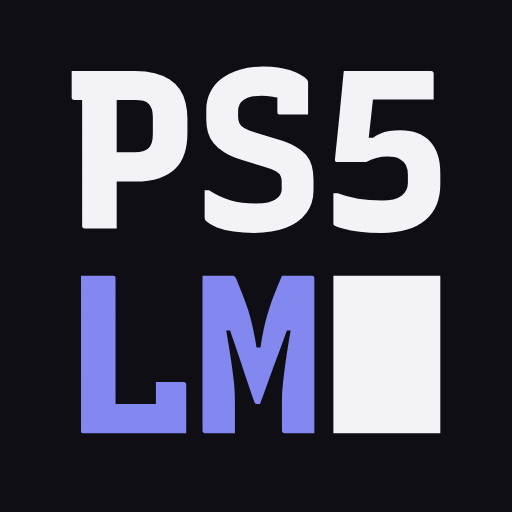
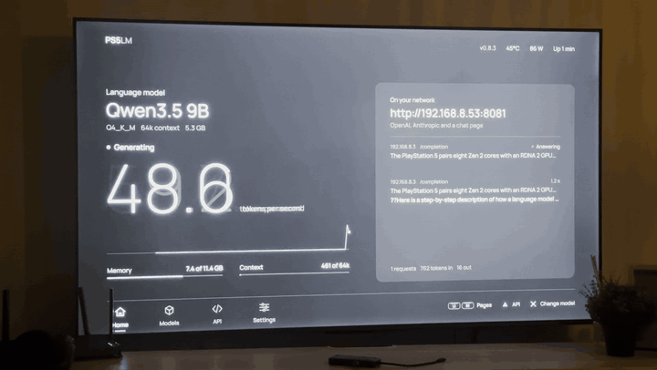
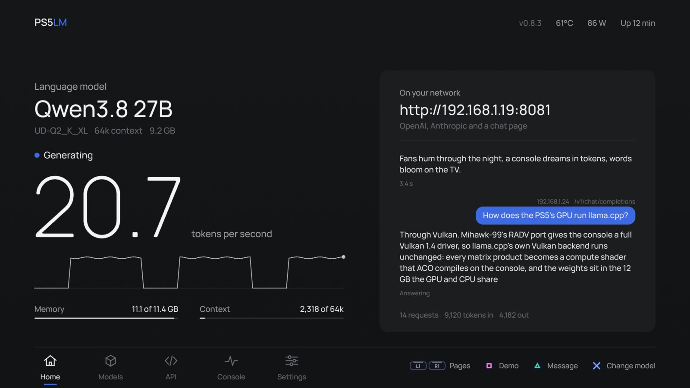
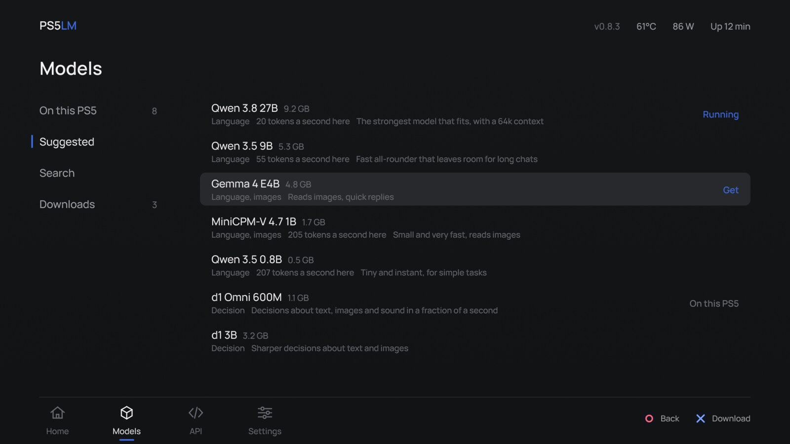
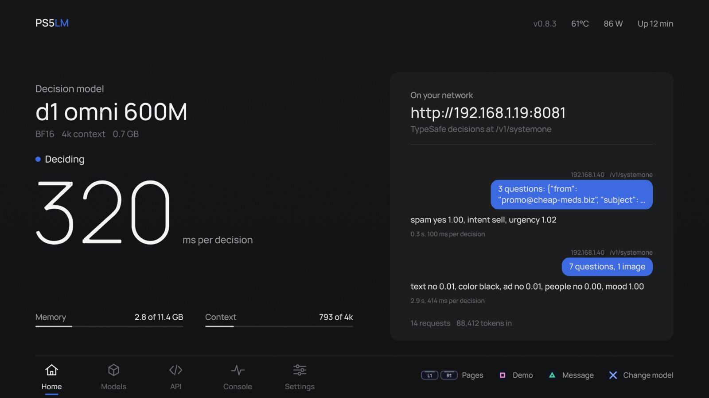
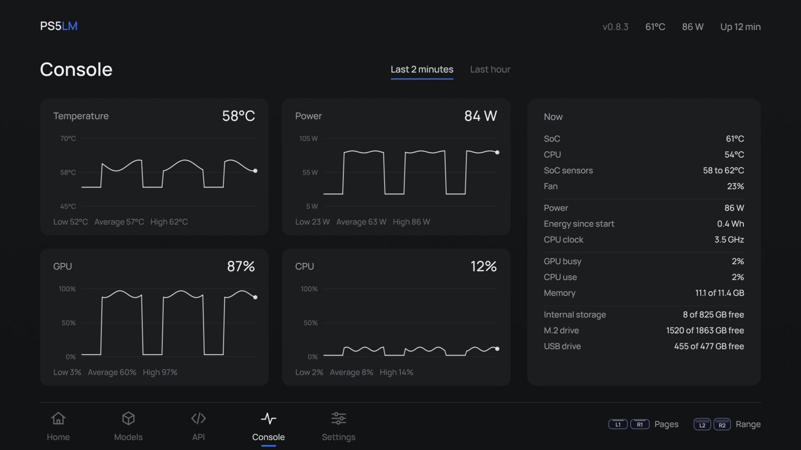
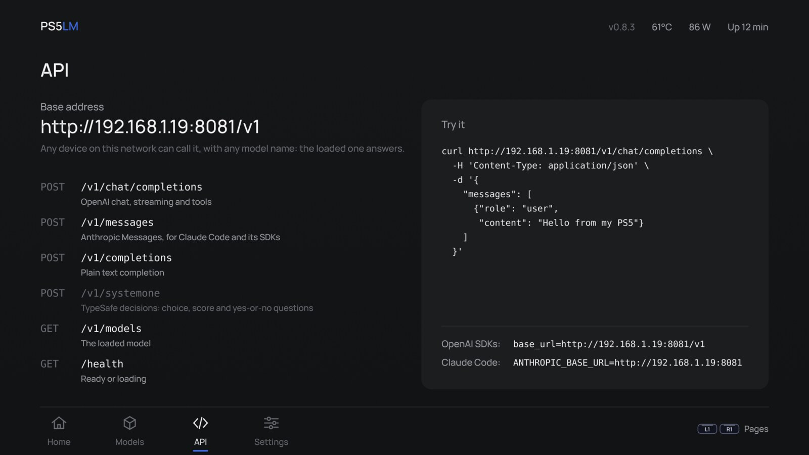
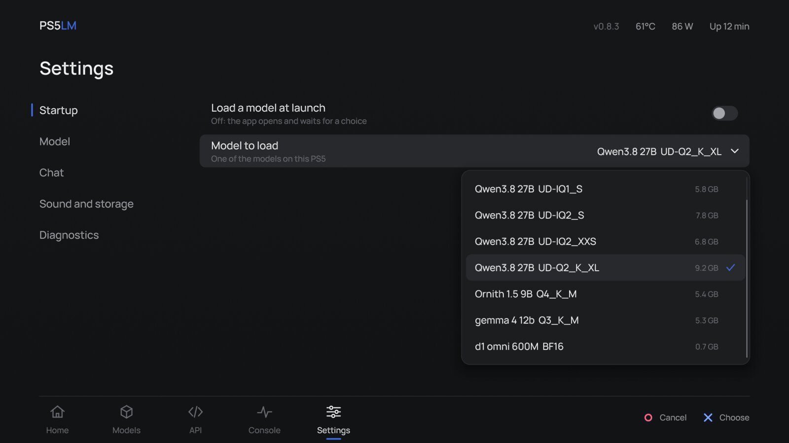

<p align="center">
  
</p>

<h1 align="center">PS5LM</h1>

<p align="center">
  <b>语言模型跑在你的 PS5 上，局域网里每台设备都能用。</b><br>
  llama.cpp 跑在主机的 GPU 上，对外提供 OpenAI 与 Anthropic 接口，还有一块为电视做的屏幕。
</p>

<p align="center">
  <b><a href="https://github.com/lswqwsl/PS5LM-zh-cn/releases/latest">下载 app</a></b> ·
  <a href="https://ps5lm.cobanov.dev">官网</a> ·
  <a href="#试一试">开始使用</a> ·
  <a href="https://github.com/lswqwsl/PS5LM-zh-cn/issues">问题反馈</a>
</p>

> **本仓库是 [cobanov/PS5LM](https://github.com/cobanov/PS5LM) 的简体中文汉化分支，版本号跟着上游走（0.11.0）。**
> 电视端五个页面、提示行、对话框，浏览器里的聊天页与模型库页都是中文；正文图集换成带 GB2312
> 汉字的 Noto Sans SC（7552 字形），所以聊天面板里模型生成的中文不再是 ???? 号。改了什么见
> [docs/LOCALIZATION.md](docs/LOCALIZATION.md)、[docs/WEBUI.md](docs/WEBUI.md)、
> [docs/QUIET.md](docs/QUIET.md)。
>
> **安装包在 [Releases](https://github.com/lswqwsl/PS5LM-zh-cn/releases/latest) 里**：
> `ps5lm-app-v0.11.0.zip`，解压得到 `PPSA99575`，覆盖到 `/data/homebrew`。界面文案编译在
> `eboot.bin` 里，没法只换字体，所以要发重新编译过的整包；想自己从头打一次，用仓库里的
> GitHub Actions 工作流（约 40~60 分钟），见
> [docs/LOCALIZATION.md 的「怎么拿到能装到 PS5 上的 zip」](docs/LOCALIZATION.md#怎么拿到能装到-ps5-上的-zip)。

> **新功能：决策模型，由 [Ollaya](https://ollaya.dev) 提供支持。** PS5LM 现在能在 GPU 上跑
> Jev 这类决策模型（d1、Clef、OpenJev 等），对外的 `/v1/systemone` 接口与 Ollaya 一致：
> 带校准概率的类型化判断，零点几秒出结果。

PS5LM 是给已破解 PS5 用户的一个家用私有模型服务。它把一个 GGUF 模型加载到主机的 GPU 上，
供你的笔记本、手机和编程工具调用。运行期间不需要 PC，不需要云，也不需要账号。

<p align="center">
  <a href="docs/media/ps5lm-home.mp4"></a><br>
  <sub>Qwen 3.5 9B 在 PS5 Slim 上回答笔记本发来的请求。点开看视频（截图是上游的英文界面）。</sub>
</p>

<p align="center">
  
  
  
  
  
  
  <br><sub>电视上的主页、模型、控制台、API 和设置。</sub>
</p>

## 电视下面的一台模型服务器

- **跑在 GPU 上。** llama.cpp 的 Vulkan 后端跑在主机的 RDNA 2 GPU 上，11.4 GB 共享内存留给模型
  和上下文。llama.cpp 认识的架构和量化都能用。
- **回答整个局域网。** OpenAI 的 `/v1/chat/completions` 和 `/v1/responses`（Codex 能直接用）、
  Anthropic 的 `/v1/messages`（Claude Code 也能用），再加任何浏览器里都能打开的聊天页。把客户端
  指向 `http://<主机>:8081`，模型名随便填：由已加载的模型回答。
- **也能做判断。** 加载一个决策模型，主机就回答 TypeSafe 的 `/v1/systemone`：针对文本和图像的
  选择、打分与是非题，也就是 Ollaya 在 PC 上提供的接口。
- **把过程显示出来。** 每个请求都以对话形式在电视上滚动：哪台设备发来的、问了什么、回答是怎么
  写出来的。□ 键发一个示例，△ 键打开键盘，坐在沙发上就能试。
- **看着这台主机。** 「控制台」页面把温度、功耗、GPU 与 CPU 负载画成曲线，可以看最近两分钟或
  最近一小时，旁边是每一项读数的表格。
- **挑放得下的方案。** 规划器读每个 GGUF，给出能放进剩余内存里的最长上下文和最佳缓存类型。
  「推荐」列表里是在主机上实测过的模型，app 自己从 Hugging Face 下载，存到内置存储、M.2 硬盘
  或 USB 硬盘。
- **能看图。** 带图像投影器的模型（Gemma 4、MiniCPM-V、d1）可以在聊天和决策里收图片。

| 模型 | 大小 | 在 PS5 Slim 上 |
|---|---|---|
| Qwen 3.5 0.8B, Q4_K_M | 0.5 GB | 207 token/秒 |
| Qwen 3.5 9B, Q4_K_M | 5.3 GB | 55 token/秒 |
| Qwen 3.8 27B, UD-Q2_K_XL | 9.2 GB | 约 20 token/秒，64k 上下文 |
| d1 Omni 600M（决策模型） | 1.1 GB | 0.3 秒答 3 个问题；720p 图片 + 7 个问题 2.9 秒 |

### 三值 Bonsai 2

PrismML 的 Bonsai 2 27B 是 Qwen 3.8 27B 的三值权重量化，`Q2_0` 只有 7.1 GB，64k 上下文还很
宽裕。它的 `Q2_0` 文件在 **模型 > 推荐** 里，app 自带的 llama.cpp 会自己做模型的 Hadamard 旋转。
PrismML 主仓库给的是 `PQ2_0`，只有他们自己的 fork 认得；在 PC 上无损转换即可（转出来的就是
PrismML 自己的 `Q2_0`，逐字节一致）：

```sh
python3 scripts/bonsai-pq2-to-q2.py Ternary-Bonsai-2-27B-PQ2_0.gguf   # 写出 Ternary-Bonsai-2-27B-Q2_0.gguf
```

## 决策模型，由 Ollaya 提供支持

[Ollaya](https://github.com/ollaya-dev/ollaya) 在 PC 上跑开源决策模型，就像 Ollama 跑语言模型一样。
PS5LM 把同样的想法搬到主机上：决策模型读一段文本，一次前向就答完类型化的问题，不生成任何文字。

```sh
curl http://<主机>:8081/v1/systemone -H 'Content-Type: application/json' -d '{
  "state": "I was charged twice this month. Refund me or I cancel.",
  "questions": {
    "intent": {"type": "choice", "instructions": "What does the customer want?",
               "criteria": {"refund": null, "information": null, "cancel": null}},
    "angry":  {"type": "noul", "instructions": "Is the customer angry?"}
  }
}'
```

「推荐」列表里有 d1 Omni 600M、d1 3B 和 Clef Flash。任何带 llama.cpp 决策元数据的 GGUF 都能
这样加载，app 会把它标成决策模型。

## 试一试

需要一台固件 7.00 到 13.60 的已破解 PS5（5.50 也有人跑通，
[#37](https://github.com/cobanov/PS5LM/issues/37)；更老的固件没测过），并加载这些 payload：

| Payload | 作用 | |
|---|---|---|
| [kstuff-lite](https://github.com/EchoStretch/kstuff-lite) | 自制软件运行所依赖的内核补丁 | 必需 |
| [etaHEN](https://github.com/etaHEN/etaHEN) | 自制软件支持 | 必需 |
| [ShadowMountPlus](https://github.com/drakmor/ShadowMountPlus) | 把 `/data/homebrew` 里的 PS5LM 放到主屏幕 | 必需 |
| [elfldr](https://github.com/ps5-payload-dev/elfldr)（9021 端口） | 通过 ps5-exporter 读温度、功耗和真实剩余空间；通过 app 自带的 ftpsrv 全速下载 | 建议 |
| [ftpsrv](https://github.com/ps5-payload-dev/ftpsrv)（2121 端口） | 安装 app、从 PC 拷模型；它在跑时下载会通过它写入 | 建议 |

1. 从 [Releases](https://github.com/lswqwsl/PS5LM-zh-cn/releases/latest) 下载 `ps5lm-app-v0.11.0.zip` 并解压。
2. 用 FTP 把 `PPSA99575` 文件夹拷到 `/data/homebrew`。ShadowMountPlus 会把 **PS5LM** 加到主屏幕。
3. 打开 PS5LM，进 **模型 > 推荐** 拿一个模型；或者把 `.gguf` 拷到 `/data/PS5LM/models`，或 U 盘上的
   `PS5LM/models`。
4. 加载它。主页显示「就绪」后，用浏览器打开 `http://<主机>:8081`，或把 OpenAI / Anthropic 客户端
   指过来。

`http://<主机>:8081` 上那一页是 app 自带的汉化聊天页（llama.cpp 自带的那套只有英文，而且在主机
浏览器上是空白页）。想换成 llama.cpp 原来那页，在 `/data/PS5LM/env.txt` 里写 `PS5LM_WEBUI=llama`；
细节见 [docs/WEBUI.md](docs/WEBUI.md)。OpenAI / Anthropic 客户端不受影响，它们走 `/v1/...`。

升级时把新文件夹覆盖旧的即可。设置、模型和下载都留在 `/data/PS5LM`。

如果 PS5LM 写不了 `/data/PS5LM`（提示“无法写入 /data/PS5LM/models”），说明 HEN 没把主机的存储
开放给它：

- **OnionHEN：** 把 `PPSA99575` 加到 `/data/OnionHEN/config.ini` 里 `[app_jailbreak]` 段的
  `exact_title_ids`，然后重新启动 PS5LM。OnionHEN 0.9.0 与 ShadowMountPlus 1.7beta10 上有人
  跑通；更早的版本会以同样的方式失败（[#23](https://github.com/cobanov/PS5LM/issues/23)）。
- **etaHEN：** 通过 FTP 建好 `/data/PS5LM/models`，把 `/data/PS5LM` 及里面的一切改成 777
  （FileZilla 里是“文件权限”，勾上应用到子目录）。etaHEN 2.6b、固件 10.00 上有人跑通。

如果 HEN 没把主机的存储（`/data`）开放给 PS5LM，app 会在第一次启动时说清楚，并提供自带的存储：
`/download0/PS5LM` 里最多 16 GB，用来放设置、日志和模型（放不下的下载会在开始前被拒绝）。
存在 app 存储里的模型会留在库里。**设置 > 音效与存储** 里能看到当前用的是哪一种。

没载模型时风扇也会明显变响：界面每秒画 60 帧，而静止的页面其实一帧都没变。这一版把没有变化的帧
跳过去，静止的界面几乎不再占 GPU，载模型前的待机也就安静下来；`/data/PS5LM/env.txt` 里写
`PS5LM_FPS=30` 还能再降一档。原理、开关和日志怎么看写在 [docs/QUIET.md](docs/QUIET.md)。

出问题时，**设置 > 调试报告** 会写出 `/data/PS5LM/debug-report.txt`（插了 U 盘时再写一份到 U 盘）：
app 版本、系统软件、存储、模型、设置、两个日志的结尾，以及哪些 payload 端口有响应，API 密钥和
token 会被去掉。把它附在 [issue](https://github.com/cobanov/PS5LM/issues) 里。内核日志只有你在
那里打开才会写进去。

在编程工具（opencode、Codex、Claude Code）里怎么用，见 [docs/CLI.md](docs/CLI.md)。

| 位置 | 按键 | 作用 |
|---|---|---|
| 任何页面 | L1 / R1 | 主页、模型、API、控制台、设置 |
| 主页 | × | 更换模型 |
| 主页 | □ / △ | 发一个示例请求 / 打一句话 |
| 模型 | 方向键、× | 选分区和模型；加载、卸载或下载 |
| 模型·搜索 | L2 / R2、□ | 换一个搜索；检查文件能不能放下 |
| 模型·下载 | ×、□ | 暂停或继续；取消（按两次）或清除 |
| 控制台 | L2 / R2 | 最近两分钟 / 最近一小时 |
| 设置 | 方向键、× | 选分类和行；开关，或从列表里挑 |
| 设置·诊断 | □、△ | app 或服务器日志；只看错误 |
| 设置·调试报告 | × | 写一个可以附在 issue 里的文件 |

## 看模型内部

这个 fork 加了一个默认关闭的接口，返回模型实际算出来的数值。`POST /v1/introspect` 会给出你指定
位置上的整行 logit、概率和熵，还能取指定层某个具名张量的一行；也可以在模型其余部分读到它之前，
就地改掉其中一个通道。

接口默认关闭，在 **设置 > 开发者 > Logits 与激活值 API** 里打开。

```sh
python3 scripts/ps5lm-introspect.py --host <主机> --prompt "Once upon a time" \
    --positions last --top-k 10 --tensors l_out --layers 12
```

[Introspection](docs/INTROSPECTION.md) 里记了请求字段、张量名和每个选项的代价。

## 想动手改？

C++ 界面用 [ps5-homebrew-ui](https://github.com/blackbearreloaded/ps5-homebrew-ui)，llama.cpp 走
[PS5_Vulkan](https://github.com/mihawk-99/PS5_Vulkan) 的 RADV 上的 ggml-vulkan，在 Linux 上构建。

[构建](docs/BUILDING.md) · [主机备忘](docs/CONSOLE.md) · [移植](docs/PORTING.md) ·
[研究](docs/RESEARCH.md) · [放得下的模型](docs/MODELS.md) · [路线图](docs/ROADMAP.md) ·
[更新日志](CHANGELOG.md) · [原来的 payload](docs/PAYLOAD.md)

## 围绕它做的东西

- [ps5lm_ha](https://github.com/phoinixgrr/ps5lm_ha)（作者 [phoinixgrr](https://github.com/phoinixgrr)）：
  一个 Home Assistant 集成，能把主机从休息模式唤醒、启动 PS5LM、等模型就绪，用完再让它睡回去，
  模型和主机的读数都作为传感器暴露出来。

## 实验性的多主机集群

[Fleet](docs/FLEET.md) 通过 llama.cpp 的 RPC 把一个 GGUF 拆到多台主机上，由一台 PC 控制：
一份模型分散在它们的内存里，而不是每台各存一份，于是一台 PS5 放不下的模型可以用两台或更多台来跑。
Qwen 3.5/3.6/3.8、Llama、Gemma 和 gpt-oss 都能拆，PC 还可以把自己的 CPU 或 GPU 作为又一个
worker 加进来。`python3 -m fleet control`（页面）和 `python3 -m fleet ctl`（JSON，给脚本和 agent
用）把多台主机和 GPU 当作一个副本池，藏在同一个 OpenAI 风格的接口后面。一个副本可以是一次拆分、
一台自己跑模型的主机，或者一块 GPU。它们会在网上找主机，并让主机进出 worker 模式。有人用一台
PS5 加一块 RTX 3080 跑过 128k 上下文的 27B 模型。worker 现在是 app 的一部分，只有
`/data/PS5LM/fleet-worker.txt` 要求时才启动（v0.10.0 时它在一个单独的 `ps5lm-app-fleet` 包里）。
双 worker 的 CPU 推理在 CI 里有测试，一台 PS5 worker 也和 PC 的 CPU、Mac 的 GPU、RTX 3090
（CUDA 与 Vulkan）一起服务过模型。它还是**实验性**的：RPC 没有认证，只能放在你信任的隔离网络里。
见[验证与限制](docs/FLEET-VALIDATION.md)。

## 致谢

- [abhi245y](https://github.com/abhi245y)：这个项目是从他做的原生 GPU app（PS5LM Plus）长出来的。
- [llama.cpp 与 ggml](https://github.com/ggml-org/llama.cpp)：真正干活的部分。
- [Mihawk-99](https://github.com/mihawk-99)：PS5 上的 PS5_Vulkan 与 RADV；
  [PS5CEMU-HAR](https://github.com/premohq/PS5CEMU-HAR)：`patches/mesa` 里的驱动补丁。
- [BlackBearReloaded](https://github.com/blackbearreloaded)：ps5-homebrew-ui、ps5-opengl 和
  ps5-homebrew-dev-protocol；[John Törnblom](https://github.com/ps5-payload-dev)：SDK。
- [Marice](https://github.com/Marice/ps5-exporter)：app 里带的 ps5-exporter。
- [Manrope](https://github.com/sharanda/manrope)（OFL）提供了原来的字形，
  [Noto Sans SC](https://github.com/notofonts/noto-cjk)（OFL）提供了汉化版的字形，
  [PocketVibe](https://github.com/cobanov/pocketvibe) 提供了界面音效。

---

GPL-3.0-or-later，见 [LICENSE](LICENSE)。llama.cpp 保留其 MIT 许可，Manrope 与 Noto Sans SC 保留
其 OFL 许可。本仓库里没有 Sony 的 SDK 文件、密钥、固件或模型权重。

PS5LM 与 Sony Interactive Entertainment 无关。“PlayStation”和“PS5”是 Sony Interactive
Entertainment 的商标。
