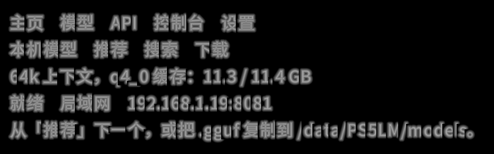

# 汉化说明

这是 [cobanov/PS5LM](https://github.com/cobanov/PS5LM) 的简体中文汉化分支。做法参照了
[Ykls53/PS5LM](https://github.com/Ykls53/PS5LM) 的汉化版（词条表 + 字符集 + 重烘字体），
但覆盖的是**上游最新版**：多出来的 fleet、调试报告、`/v1/responses`、图像输入、决策模型、
下载队列这些页面和文案都在里面。基线是上游 `6d60345`（v0.11.0），三个 submodule 的 gitlink
按上游发布的版本固定。

## 一眼看懂改了什么

| 东西 | 动了没有 | 说明 |
|---|---|---|
| 电视端界面（主页、模型、API、控制台、设置） | ✅ 全中文 | `ps5/app/dashboard.cpp` 的词条表替换 |
| 提示行、对话框、忙碌页 | ✅ 全中文 | 同上 |
| 通知（右上角弹条）、重启/加载时的说明 | ✅ 全中文 | `ps5/app/main.cpp` |
| 模型规划文案（「64k 上下文，q4_0 缓存：11.3 / 11.4 GB」） | ✅ 全中文 | `ps5/app/model_plan.cpp` |
| 模型库、搜索、下载状态与失败原因 | ✅ 全中文 | `ps5/app/market.cpp` |
| 「推荐」列表里的模型介绍 | ✅ 全中文 | `ps5/app/suggested.hpp` |
| 请求面板里的「3 个问题」「是 0.87」「错误：…」 | ✅ 全中文 | `ps5/app/activity.cpp` |
| 硬盘名（内置存储 / 应用存储 / M.2 硬盘 / USB 硬盘） | ✅ 全中文 | `stats.cpp`、`storage.cpp`，dashboard 里的比较也一起改了 |
| 浏览器聊天页（llama.cpp 自己的 UI） | ✅ 全中文 | `patches/0014-webui-chinese.patch` 改 `tools/ui/src` 的 395 条文字，构建时编进 `llama-server`（[WEBUI.md](WEBUI.md)） |
| 模型库页（payload 那条路） | ✅ 全中文 | `ps5/ps5lm/library.html` |
| 集群控制页（`python3 -m fleet control`） | ✅ 全中文 | `fleet/control.html`；页面里那些运行时状态文字来自 Python 控制服务器，仍是英文 |
| README、`docs/LOCALIZATION.md`、`docs/WEBUI.md` | ✅ 全中文 | 其余 `docs/*.md`、`site/` 保留英文（面向构建与上游对照） |
| 版本号 | ✅ 和上游一致（`0.11.0`） | `ps5/app/version.hpp` 与 `param.json` 的 `contentVersion`（`01.011.000`），发布 tag 也是 `v0.11.0` |
| 字体 | ✅ 换成 Noto Sans SC | `ps5/app/assets/fonts/manrope-*.huifont` 重新烘焙见下 |
| `app.log` / `llama.log` 日志行、llama-server 参数、API 路径、JSON 字段 | ❌ 保留英文 | 这些是给人和工具抓错误用的，翻了反而搜不到 |

## 为什么必须重烘字体

`main.cpp` 从 `assets/fonts` 加载 `manrope-200/500/600.huifont`（SDF 字体图集），一套字体只有
烘进去的字形。上游烘的是 Manrope + 欧洲字符集，里面一个汉字都没有 —— 界面文案换成中文后，
屏幕上就是一片 `????`。

汉化版把这三个文件换成了 **Noto Sans SC**（OFL 1.1）烘出来的图集，文件名不变，`main.cpp`
的加载路径不用动。两套字符集，理由不同：

* `charset-ui.txt` —— 源码里出现过的界面字符（约 530 个）。标题和大数字用的 600 / 200 字重
  只装这一套就够。
* `charset-chat.txt` —— 界面的字 **加上 GB2312 全集**（6763 汉字 + 682 符号）。因为聊天面板
  显示的是**模型生成的中文**，任意汉字都可能出现；只装界面那几百个字，模型一开口还是 `????`。
  这是汉化第一版翻车的地方，正文那个字重（regular = `manrope-500`）必须装全集。

重新烘焙（需要 Python 的 fontTools 和一个主机 C++ 编译器）：

```sh
python3 -m pip install fonttools
# 字体是可变字体，必须是 TrueType 轮廓（00 01 00 00）：stb_truetype 不认 CFF/OTF
curl -L -o .deps/fonts/NotoSansSC-VF.ttf \
  'https://raw.githubusercontent.com/google/fonts/main/ofl/notosanssc/NotoSansSC%5Bwght%5D.ttf'
scripts/bake-fonts.sh                     # = python3 scripts/bake-fonts-cn.py
```

脚本会：编译 `scripts/font-baker/bake_font.cpp`（改了上游那份，第 7 个参数支持
`@字符集文件`）→ 跑 `scripts/gen-charset.py` 生成两套字符集 → 用 fontTools 从可变字体切出
200/500/600 三个静态字重 → 烘焙三个 `.huifont` → **读回来核对每个字符都在**，缺字就报错退出。
产物直接进 git，控制台侧不需要字体工具链。

烘焙参数（`bake-fonts-cn.py` 顶部的 `BAKES`）：

| 文件 | 字重 | 像素 | SDF 范围 | atlas | 字符集 |
|---|---|---|---|---|---|
| `manrope-500.huifont` | 500（正文、聊天） | 36 | 6 | 4096² | UI + GB2312 |
| `manrope-600.huifont` | 600（标题、表格状态） | 64 | 8 | 4096² | UI |
| `manrope-200.huifont` | 200（大数字） | 64 | 8 | 4096² | UI |

6763 个汉字在 36px 下约 15.6M 像素，正好塞满 4096²；换成 64px 就放不下了。

下面这张图不是截图，是把 `manrope-500.huifont` 的图集直接按字形矩形和 advance 拼出来的
（`scripts/render-font-sample.py` 做的事）：能读出来，就说明这些字真的烘进字体里了。



### 必须记住的坑：`read_file` 的 4 MiB 上限

kit 的 `hui::save::read_file`（`third_party/ps5-homebrew-ui/src/core/save_file.hpp`）默认
`max_bytes = 4u << 20`。上游 Manrope 每个字重约 1.8 MB，永远碰不到这个上限；汉化版的正文字集
是 **15.94 MB**，于是：

`read_file` 在 4 MiB 处返回 false → `load_font` 失败 → `ui_ok` 为假 →
`while (ui_ok && !booted)` 一次都不进 → **进 app 一直黑屏**（第一版汉化包就是这么挂的）。

`main.cpp` / `preview_main.cpp` 的 `load_font` 现在显式传 `32u << 20`，别改回默认。
`release-zh.yml` 里还有一道门禁：构建完用同一段代码（`read_file(…, 32 MiB)` + `Font::load`）
把包里四个字体实跑一遍，读不进来就让构建失败，这类静默黑屏不会再发布出去。

## 词条表与替换脚本

* `scripts/translations-zh.csv` —— 382 条，列是 `file,en,zh`。要改某个词的译法，改这里。
* `scripts/apply-translations.py` —— 只替换**带双引号的完整字面量**（`"Load"` 不会误伤
  `"Loading"`），源码里用 `\xNN` 转义写的符号也认得；有漏项时退出码为 1。原文件留一份
  `*.en.bak`（已在 `.gitignore` 里）。

在干净的源码树上一遍跑完：

```sh
python3 scripts/apply-translations.py .        # 438 处
```

译法规则：`printf` 占位符（`%s` `%.1f` `%zu` `%%`）原样保留、顺序不变；拼接处的首尾空格保留；
JSON 键名、`auto`/`none`、`.gguf`、量化名、仓库 id、API 路径、守护进程名、系统调用名一律不译；
标点用中文全角，中英文之间留一个空格。

## 改完怎么自查

```sh
python3 scripts/check-zh.py          # UTF-8、CRLF、引号成对、词条表干净（0 问题才算过）
python3 scripts/fitcheck-zh.py       # 每条译文的排版宽度和英文比，列出反而更宽的那些
python3 scripts/apply-translations.py . --dry-run
```

`fitcheck-zh.py` 用烘好的字体量字宽：界面是按固定位置排版的，译文比原文宽太多就会挤到邻居身上。
正常情况下列表很短（中文大多比英文窄）；出现宽度比接近或超过 1 的地方，最好把那条译短一点。

## 词条表覆盖不到的改动（手工改的代码）

这些是逻辑，不是文案，所以没进 CSV：

1. **`dashboard.cpp` 的 `wrap()`** —— 中文没有空格，一整段会是一个“词”，贪心断词断不开。
   加了一段：一行还是放不下就**按 UTF-8 字符**断行（每个多字节序列保持完整，否则最后一个字符
   会变成 U+FFFD）。聊天面板、存储对话框、调试报告对话框都靠它。
2. **`model_plan.hpp` 常量 `kDecisionPlanTag` / `kDecisionPlanSep`** —— 规划文案里
   `决策模型（clef），64k 上下文…` 这个前缀，在「模型」页要剥掉（那一行已经写了「决策」）。
   两处共用一个常量，免得哪天改了格式对不上。
3. **`activity.cpp`** —— 英文的 `" question" / " questions"` 单复数分支翻成中文后没意义了，
   改成 `" 个问题"`、`"，" + N + " 张图"`、`"："`。
4. **`main.cpp` 里 `text + 7`** —— 往日志里写时跳过 `"PS5LM: "` 前缀。中文冒号让前缀变成
   8 字节，改成 `text + std::strlen("PS5LM：")`。
5. **`dashboard.cpp` 下载行的分隔符** —— `", "` 换成 `"，"`（三处），以及「可放入 X。」的句号。
6. **硬盘名比较** —— `dashboard.cpp` 里有 `d.name == "应用存储"` 和
   `m.drive != "内置存储"`，必须和 `stats.cpp` / `storage.cpp` 里的名字一字不差。
7. **`model_plan_test.cpp`** —— 断言跟着改成用上面那两个常量拼。

## 文件清单

新增：

```
scripts/translations-zh.csv        词条表
scripts/apply-translations.py      替换脚本
scripts/gen-charset.py             从源码提取字符集 + GB2312
scripts/bake-fonts-cn.py           烘焙三个字重（跨平台，Python）
scripts/check-zh.py                编码/换行/引号/词条表自查
scripts/fitcheck-zh.py             译文排版宽度对比
scripts/render-font-sample.py      把 .huifont 里的字拼成 PNG（验证字形）
docs/media/localization-font.png   上面那个脚本对 manrope-500 的输出
.github/workflows/release-zh.yml   在 GitHub Actions 上交叉编译并打包成 zip
scripts/font-baker/bake_font.cpp   改了上游那个烘焙器：支持 @字符集文件
scripts/font-baker/font_format.hpp .huifont 的二进制布局
docs/LOCALIZATION.md               本文件
docs/WEBUI.md                      :8081 那一页是怎么接上的
patches/0014-webui-chinese.patch   llama.cpp 的网页 UI 换成中文（tools/ui/src）
ps5/app/assets/fonts/noto-sans-sc-LICENSE.txt
```

改动：

```
scripts/bake-fonts.sh              变成 bake-fonts-cn.py 的壳（上游那份 Manrope 做法留在注释里）
scripts/build-app.sh               用 npm 构建并内嵌已汉化的网页 UI，并带 Noto 的许可
README.md                          中文
ps5/app/*.cpp, *.hpp               见上表
ps5/app/assets/fonts/*.huifont     重新烘焙（Noto Sans SC）
patches/0014-webui-chinese.patch   网页 UI 的中文文案（395 条）
ps5/ps5lm/library.html             模型库页
fleet/control.html                 集群控制页（中文）
.github/workflows/release-zh.yml   打中文包；并检查包里字体、字体图集、eboot 里的中文网页 UI
.gitignore                         *.en.bak、.deps/fonts/
```

## 已知限制

* **主机上的键盘只打得出拉丁字母。** 手柄键盘（`ui::KeyboardLayout::letters()`）没有拼音输入，
  所以「△ 键发自己的话」只能打英文/数字；要看中文，用「□ 键发示例」或者浏览器里那个聊天页
  （那边是你自己的手机/电脑键盘）。这是上游界面的限制，不是汉化造成的。
* **截图和 GIF 还是英文的。** `docs/media/` 里是上游截的图；要在中文界面上重截，得在 Linux 上跑
  `scripts/preview-app-ui.sh`（需要 Mesa 的 surfaceless EGL）。
* **日志面板的中文字体是 DejaVu Sans Mono**（来自 ps5-homebrew-ui），里面没有汉字。所以日志行、
  API 页的 curl 示例、`llama-server` 参数都保持英文——它们本来就该是英文。
* **`docs/` 其余文档和 `site/` 没有翻译**，它们面向的是构建、移植和集群调试，翻成中文反而不好和
  上游对照。
* **集群控制页的运行时文字还是英文**：页面本身的标签、按钮、提示都是中文了，但「活动」面板里的
  状态行来自 `fleet/control.py` 的 job/note 消息（也会出现在 `ctl` 的命令行输出里），这一层没翻。
* **`ps5/ps5lm/app.cpp`（payload 那一侧）的消息**保持英文：它是 HTTP 响应和 llama-server 的
  包装层，改了会让客户端和 issue 里的报错对不上。

## 怎么拿到能装到 PS5 上的 zip

**仓库里没有现成的 zip，这不奇怪：界面文案是编译进 `eboot.bin` 的。** 上游 release 里的
`PPSA99575` 文件夹中，`eboot.bin` 是编译产物，`assets/fonts/*.huifont` 才是单独的资源。所以
"拿上游的包、只把字体换掉"是行不通的 —— 那样只会变成"英文界面 + 中文字体"。要中文界面，
必须交叉编译。编译好的包放在本仓库的
[Releases](https://github.com/lswqwsl/PS5LM-zh-cn/releases/latest)（`ps5lm-app-v0.11.0.zip`），
版本号和上游 0.11.0 一致。

要自己编，两条路，选一条：

### 路线 A：让 GitHub Actions 编（不用自己有 Linux）

仓库里带了 `.github/workflows/release-zh.yml`，和上游 CI 用的是同一个 Debian trixie 镜像、
同一套 pinned SDK/RADV/llama.cpp：

1. 把这个仓库推到你自己的 GitHub（私有仓库也行）；
2. 打开 **Actions → 打包汉化版（PS5 title zip）→ Run workflow**（推到 `main` / `zh-cn` 分支或
   打 `v*` tag 也会自动跑）；
3. 等 40~60 分钟，在该次运行的 **Artifacts** 里下载 `ps5lm-app-zh-v0.11.0.zip`（含 `.sha256`）。

工作流会先检查字体是不是汉化版（`manrope-500` 必须装够 7000+ 字形），打包后再比对包里的
`.huifont` 和仓库里的是否一致，防止"拿英文字体打出来的包"混进来。免费额度和 2 核跑满 1 小时
的开销，以及 artifact 30 天保留期，自己留意一下。

### 路线 B：在本机 Linux（或 WSL2 Ubuntu）上编

需要 clang/llvm 19、ninja、meson 等，具体清单见 [BUILDING.md](BUILDING.md)；Mesa 的 RADV 要
按 `patches/mesa/README.md` 手工打补丁 —— 这一串是上游的构建链，汉化没有动它：

```sh
git submodule update --init --depth 1
scripts/bake-fonts.sh          # 只在改了文案时必要：重烘三个字重
scripts/build-app.sh           # 交叉编译，产出 build/app-ps5/title/PPSA99575
scripts/release-app.sh         # 打包成 build/release/ps5lm-app-v<版本>.zip
```

`release-app.sh` 会校验 `CHANGELOG.md` 里有 `## [<版本>]` 条目、`param.json` 的 `contentVersion`
与 `version.hpp` 对应（当前 v0.11.0 ↔ `01.011.000`，都已就绪）。

### 装到主机上

1. 解压 zip，得到 `PPSA99575` 文件夹；
2. 用 FTP 拷到主机的 `/data/homebrew`（ShadowMountPlus 会把 **PS5LM** 放到主屏幕）；
3. 打开 PS5LM，**模型 > 推荐** 拿一个模型，或把 `.gguf` 放到 `/data/PS5LM/models`；
4. 加载，等主页显示「就绪」，然后用浏览器打开 `http://<主机IP>:8081`。

升级时把新的 `PPSA99575` 整个覆盖旧的；设置、模型、下载都在 `/data/PS5LM`。

## 构建

三个 submodule 的 gitlink 已经按上游发布的版本固定好，拉下来直接初始化即可：

```sh
git submodule update --init --depth 1      # llama.cpp / ps5-homebrew-ui / ftpsrv
```

`third_party/ps5-homebrew-ui` 的版本很重要：`scripts/font-baker/bake_font.cpp` 里的
`font_format.hpp` 必须和它 `src/gfx/font_format.hpp` 一致（当前两者逐字节相同，脚本烘完会
读回来核对字形），否则烘出来的字体 app 读不了。之后按 [BUILDING.md](BUILDING.md) 的步骤来
（需要 PS5 的 payload SDK 和 Vulkan 头）。字体和页面的产物已经在仓库里，控制台侧不需要
fontTools，也不需要重新生成页面。

## 和上游同步

```sh
git remote add upstream https://github.com/cobanov/PS5LM.git
git fetch upstream && git merge upstream/main
python3 scripts/apply-translations.py . --dry-run   # 看新文案还差哪些词条
```

`--dry-run` 列出所有没命中的词条：新版本新增的英文会出现在这里，补进 CSV 再跑一遍真替换，
最后 `scripts/bake-fonts.sh` 重烘字体（新文案里可能出现新的汉字）。
